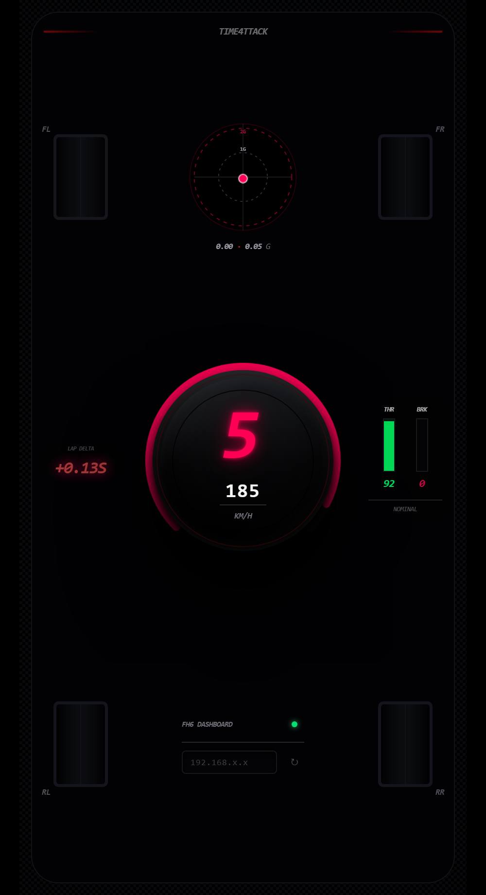
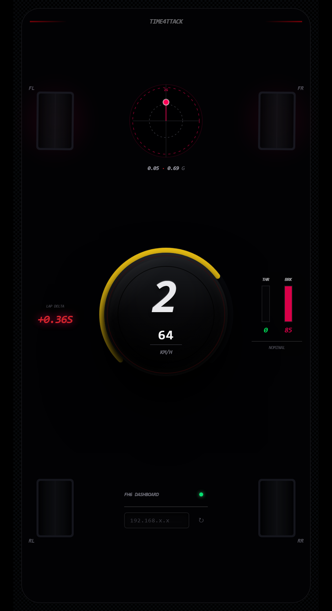
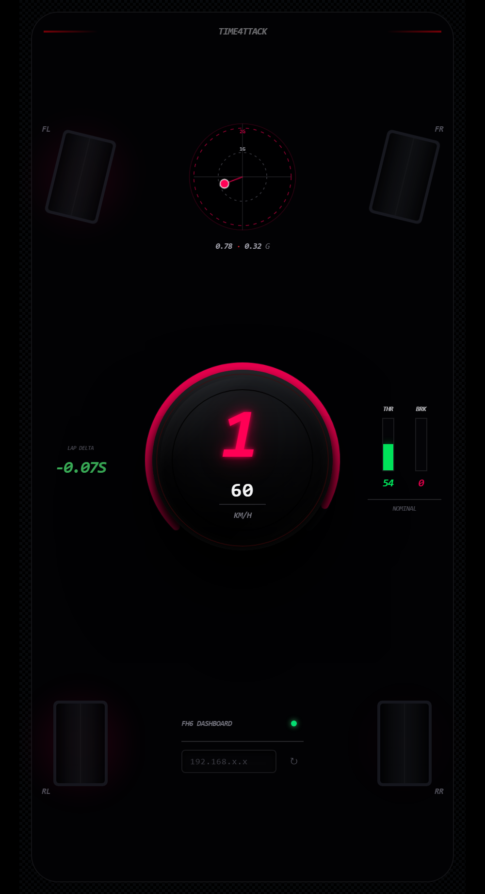
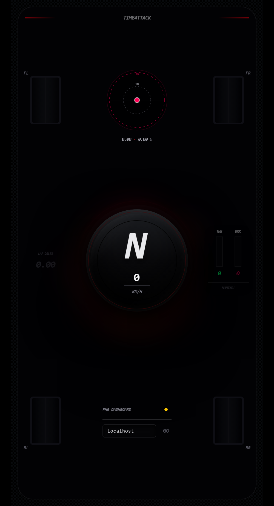
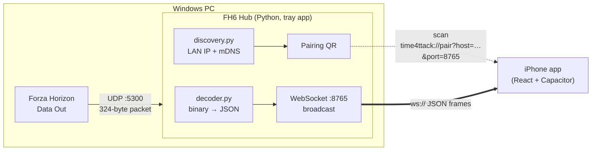

<div align="center">

# Time4ttack · FH6 Telemetry Dashboard

**A second-screen race dashboard for Forza Horizon: the PC streams live telemetry, the phone becomes the instrument cluster.**

React 19 · TypeScript · Zustand · Tailwind CSS · Capacitor (iOS) · Python asyncio Hub for Windows

[**▶ Live demo**](https://rhapsody027.github.io/FH6-mobile-telemetry-dashboard/) — runs on simulated telemetry, no game required

</div>

<p align="center">
  
  
  
  
</p>
<p align="center"><sub>Straight · Threshold braking · Corner exit · Standby (waiting for Hub)</sub></p>

---

## What it does

Forza Horizon can stream a 324-byte UDP "Data Out" packet every frame. Time4ttack turns that into a glanceable, phone-sized HUD:

| Cell | Shows |
| --- | --- |
| **Gear / speed core** | Gear, km/h, and an RPM arc that turns into a shift light near the limiter |
| **G-force scope** | Combined lateral and longitudinal G on a 2 G friction circle |
| **4× wheel cells** | Per-tyre slip ratio and slip angle; front tyres rotate with steering input; glow on lock-up or wheelspin |
| **Pedals** | Throttle and brake bars with overlap detection |
| **Lap delta** | ± seconds against the reference lap |
| **Pairing cell** | Connection status plus manual IP entry as a fallback to QR |

## Architecture



- **Hub (`fh6-hub/`)**: an asyncio service in the Windows tray. It decodes Forza's packet, throttles it to about 30 Hz, and fans it out to every connected phone over WebSocket.
- **Dashboard (`src/`)**: a React app in a Capacitor iOS shell. Frames are coalesced into one Zustand update per `requestAnimationFrame`, so the UI never renders faster than the screen.
- **Pairing**: the Hub encodes its LAN address into a `time4ttack://pair` deep link and shows it as a QR code. Scanning it opens the app and connects. Typing the IP by hand still works.

### Engineering details worth a look

- **Real LAN IP selection** ([`discovery.py`](fh6-hub/discovery.py)): enumerates adapters with `ifaddr`, prefers physical Wi-Fi or Ethernet, and rejects loopback, link-local, VPN, Docker, Tailscale, Hyper-V/VM, Bluetooth and Wi-Fi Direct adapters, so the QR never points at an unreachable address. If no usable IPv4 exists, it skips the QR and leaves manual entry available.
- **Fault-tolerant startup** ([`main.py`](fh6-hub/main.py)): an mDNS name collision is handled and the Hub keeps running; a busy UDP port (another Hub instance) gets a clear error instead of a stack trace.
- **Frame coalescing** ([`useTelemetry.ts`](src/useTelemetry.ts)): incoming WebSocket messages overwrite a pending slot that drains once per animation frame, so a bursty network can't cause dropped frames.
- **Resolution-independent HUD** ([`ScaleStage.tsx`](src/components/ScaleStage.tsx)): the layout is designed at a fixed 460×920 reference and scaled to the device's safe area.
- **Game-aware autostart** ([`fh6_watcher.py`](fh6-hub/fh6_watcher.py)): an optional watcher launches the Hub only when a Forza process appears.
- **Shipping** ([`build_windows_installer.ps1`](fh6-hub/build_windows_installer.ps1), [`Time4ttackFH6Hub.iss`](fh6-hub/installer/Time4ttackFH6Hub.iss)): a PyInstaller bundle plus an Inno Setup installer with startup-mode options, clean uninstall, and SHA-256 checksums.

## Try it

### Demo mode (no game, no Hub)

```bash
bun install
bun run dev          # then open http://localhost:5173/?demo
```

`?demo` swaps the WebSocket feed for a built-in lap simulator ([`src/demoTelemetry.ts`](src/demoTelemetry.ts)). It produces the same JSON shape the Hub sends: upshifts down a straight, ABS-pulsing threshold braking, a trail-braked corner, and wheelspin on exit, with corner direction alternating every lap. `?demo=9` jumps 9 s into the lap. Builds made with `VITE_DEMO=true` start in demo mode, which is how the GitHub Pages demo is deployed ([workflow](.github/workflows/pages.yml)).

### Full pipeline on one PC (synthetic UDP)

```powershell
cd fh6-hub
uv sync
uv run python main.py     # Hub: UDP :5300 → WebSocket :8765, shows pairing QR
uv run python mock.py     # second terminal: 60 Hz fake Forza packets
```

Then run `bun run dev` and enter the PC's LAN IP in the dashboard's pairing cell.

### With the real game

1. In Forza Horizon go to **Settings → HUD and Gameplay → Data Out**, set it **On**, IP `127.0.0.1`, port `5300`.
2. Start the Hub from the installer or with `uv run python main.py`.
3. Scan the QR with the iPhone (the app registers `time4ttack://`), or type the IP shown by the Hub.

### iOS build

```bash
bun run cap:sync     # builds the web app and syncs it into ios/
bunx cap open ios    # opens ios/App/App.xcodeproj (Swift Package Manager, no CocoaPods)
```

## Repository layout

```
src/                 React dashboard (cells, telemetry store, demo simulator)
ios/                 Capacitor iOS shell: URL scheme, local-network/ATS, native mDNS bridge
fh6-hub/             Windows Hub: decoder, WebSocket relay, LAN discovery, tray, QR, watcher
  installer/         Inno Setup script
  release/           Release docs and templates (built binaries go to GitHub Releases)
server/              Early TypeScript prototypes: UDP recorder/replayer and WS relay
docs/screenshots/    README images (generated from demo mode)
```

## Project status

**Complete and archived.** I built this as a personal tool while playing Forza Horizon and stopped active work once it did what I needed. The pairing flow, Hub, installer and dashboard are all implemented. What hasn't been through a formal pass is the hardware test matrix: Wi-Fi client isolation, firewall prompts on fresh installs, and multiple Hub instances on one network.

Telemetry packet layout follows Forza's public "Data Out" (Dash) format. This is a fan project, not affiliated with or endorsed by Microsoft, Xbox Game Studios or Playground Games.
